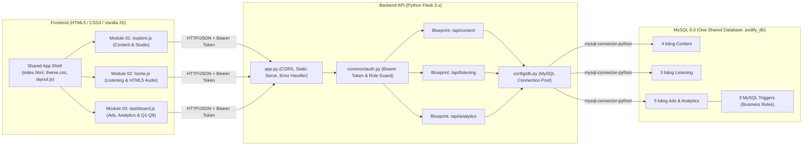

# System Architecture — Podify

Tài liệu mô tả kiến trúc tổng thể **Client–Server (3-Tier)** của hệ thống **Podify**: Giao diện Web thuần (Frontend) ↔ RESTful API Python Flask (Backend) ↔ Cơ sở dữ liệu tập trung MySQL 8.0 (Shared Database).

---

## 1. Sơ đồ kiến trúc tổng thể

---

## 2. Cấu trúc phân tầng Backend (`backend/`)

- **`config/settings.py` & `config/db.py`:** Đọc biến môi trường từ `.env`, quản lý `MySQLConnectionPool` (`utf8mb4_unicode_ci`) và chuẩn hóa mã lỗi MySQL thành các HTTP exception rõ ràng:
  - `1062` (Duplicate Entry) → `409 Conflict` (`DB_DUPLICATE_ENTRY`)
  - `1644` (Trigger `SIGNAL SQLSTATE '45000'`) → `400 Bad Request` (`DB_TRIGGER_VIOLATION`)
  - `1451/1452/3819/...` (FK / CHECK / NOT NULL) → `400 Bad Request` (`DB_CONSTRAINT_VIOLATION`)
  - `2002/2003/1045/...` (Lỗi kết nối) → `503 Service Unavailable` (`DB_UNAVAILABLE`)
- **`common/auth.py`:** Dùng `itsdangerous.URLSafeTimedSerializer` ký và xác thực Bearer Token có thời hạn, kết hợp `werkzeug.security` (`pbkdf2:sha256`) để băm mật khẩu an toàn; cung cấp decorator `@login_required` và `@roles_required(...)`.
- **`common/response.py`:** Chuẩn hóa mọi phản hồi JSON dạng `{ "ok": true, "data": ... }` hoặc `{ "ok": false, "error": ..., "code": ... }`, tự động chuyển đổi `Decimal`, `datetime`, `date`, `timedelta` từ MySQL driver sang JSON hợp lệ.
- **`modules/`:** Chia 3 Flask Blueprints độc lập tương ứng 3 thành viên nhưng truy cập chung `podify_db`.
- **`app.py`:** Phục vụ luôn tệp tĩnh trong `frontend/` tại `/` và `/assets/...`, giúp triển khai local chỉ với 1 tiến trình duy nhất trên cổng `5000`.

---

## 3. Luồng xử lý nghiệp vụ xuyên 3 phân hệ

1. **Creator đăng nội dung (`Module 01`):** Đăng nhập → nhận Bearer Token → gọi `POST /api/content/channels` & `POST /api/content/episodes` để lưu vào `PodcastChannels` và `Episodes`.
2. **Người nghe tương tác (`Module 02`):** Xem danh sách tập → phát file MP3 qua `<audio>` → gọi `POST /api/listening/progress` cập nhật `ListeningHistory`, gọi `POST /api/listening/subscriptions` và `POST /api/listening/ratings`.
3. **Quảng cáo & Phân tích (`Module 03`):** Creator tạo `Advertisements` và `AdContracts` → gắn vào tập qua `POST /api/analytics/slots` (MySQL Trigger tự kiểm tra quy tắc `< 20 phút` tối đa 3 hợp đồng) → người nghe Donate (`POST /api/analytics/donations`) → hệ thống tổng hợp báo cáo `Q1`–`Q8`.
