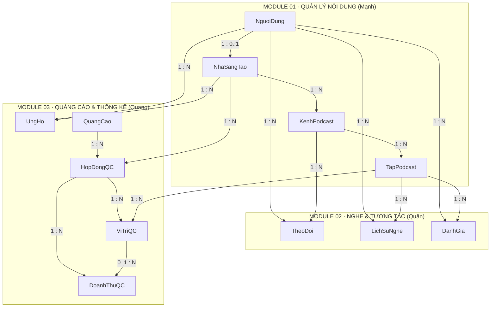

# BÁO CÁO TỔNG HỢP PHẦN CƠ SỞ DỮ LIỆU — DỰ ÁN PODIFY

> **Hệ quản trị CSDL:** MySQL 8.0 (`podify_db`, bảng mã `utf8mb4` / `utf8mb4_unicode_ci`)  
> **Quy mô:** 12 bảng chuẩn 3NF · 17 khóa ngoại (FK) · ~271 bản ghi dữ liệu mẫu · 8 truy vấn phân tích chuẩn Đề 18  
> **Nguồn cài đặt:** [full_schema.sql](file:///C:/Users/win10/Desktop/demo/database/schema/full_schema.sql) · [full_seed.sql](file:///C:/Users/win10/Desktop/demo/database/seed/full_seed.sql) · [queries.sql](file:///C:/Users/win10/Desktop/demo/database/queries/queries.sql)

---

## 1. Tổng quan kiến trúc & Phân chia 3 Module

CSDL `podify_db` quản lý trọn vẹn vòng đời của một nền tảng Podcast & Nội dung âm thanh, được tổ chức thành **3 phân hệ (module)** liên kết chặt chẽ với nhau qua khóa ngoại:

| Phân hệ | Phụ trách | Các bảng (12 bảng) | Vai trò cốt lõi |
| :--- | :--- | :--- | :--- |
| **Module 01** — Quản lý Nội dung | **Mạnh** | `NguoiDung`, `NhaSangTao`, `KenhPodcast`, `TapPodcast` | Định danh người dùng, nâng cấp tài khoản Creator, quản lý kênh và các tập audio podcast. |
| **Module 02** — Nghe & Tương tác | **Quân** | `TheoDoi`, `LichSuNghe`, `DanhGia` | Theo dõi kênh (bật/tắt thông báo), lưu tiến độ nghe dở/đã nghe xong, đánh giá 1–5 sao & bình luận. |
| **Module 03** — Quảng cáo & Thống kê | **Quang** | `UngHo`, `QuangCao`, `HopDongQC`, `ViTriQC`, `DoanhThuQC` | Ủng hộ (donate) Creator, quản lý chiến dịch QC, ký hợp đồng QC, phân bổ vị trí chèn QC vào tập và ghi nhận doanh thu. |

---

## 2. Luồng phân tích & thiết kế CSDL (4 giai đoạn)

### Giai đoạn 1: Phân tích yêu cầu & Mô hình hóa khái niệm (ERD chuẩn Chen)
- Xác định **12 thực thể** và **17 mối quan hệ** nghiệp vụ.
- Thiết kế nhất quán kiểu khóa chính định danh dạng chuỗi `VARCHAR(10)` có tiền tố nhận diện nghiệp vụ (`ND0001`, `NST0001`, `KP0001`, `EP0001`, `TD0001`, `LS0001`, `DG0001`, `UH0001`, `QC0001`, `HD0001`, `VT0001`, `DT0001`) giúp dễ truy vết khi kiểm thử và demo.
- Tách bạch rõ các quan hệ có thuộc tính riêng thành thực thể liên kết (`TheoDoi`, `LichSuNghe`, `DanhGia`, `ViTriQC`) thay vì gắn thuộc tính trực tiếp lên hình thoi.

### Giai đoạn 2: Chuyển đổi sang Lược đồ quan hệ (Relational Schema)
1. **Quan hệ `1 : 0..1` (`NguoiDung` → `NhaSangTao`):** Đặt khóa ngoại `ma_nguoi_dung` trong `NhaSangTao` kèm ràng buộc `UNIQUE NOT NULL` để đảm bảo mỗi người dùng chỉ có tối đa 1 hồ sơ Nhà Sáng Tạo, còn người nghe thường không cần sinh bản ghi thừa.
2. **Quan hệ `1 : N`:** Đưa khóa chính bên `1` sang làm khóa ngoại bên `N` (ví dụ `ma_creator` trong `KenhPodcast`, `ma_kenh` trong `TapPodcast`).
3. **Loại bỏ toàn bộ quan hệ `N : N`:**
   - `NguoiDung ↔ KenhPodcast` → bảng trung gian `TheoDoi` với `UNIQUE(ma_nguoi_dung, ma_kenh)`.
   - `NguoiDung ↔ TapPodcast` (đánh giá) → bảng `DanhGia` với `UNIQUE(ma_nguoi_dung, ma_tap)` (mỗi người chỉ đánh giá 1 lần/tập, có thể cập nhật).
   - `NguoiDung ↔ TapPodcast` (nghe nhiều lần) → bảng `LichSuNghe` (không đặt `UNIQUE` cặp `(ma_nguoi_dung, ma_tap)` vì một người có thể nghe lại một tập nhiều phiên khác nhau).
   - `HopDongQC ↔ TapPodcast` → bảng `ViTriQC` với `UNIQUE(ma_hop_dong, ma_tap, vi_tri)` (1 hợp đồng có thể gắn đầu/giữa/cuối tập nhưng không trùng cùng vị trí trên cùng 1 tập).
4. **Quan hệ tùy chọn `0..1 : N` (`ViTriQC` → `DoanhThuQC`):** Cột `ma_vi_tri` cho phép `NULL` với `ON DELETE SET NULL`, cho phép ghi nhận doanh thu khoán theo hợp đồng dù chưa gắn vị trí cụ thể, đồng thời bảo toàn lịch sử doanh thu nếu vị trí quảng cáo bị gỡ bỏ.

### Giai đoạn 3: Kiểm chứng Chuẩn hóa (1NF → 2NF → 3NF)
- **Đạt 1NF (Dạng chuẩn 1):** Mọi cột đều chứa giá trị nguyên tử (không có mảng/danh sách ngăn cách dấu phẩy trong một ô; các tập của kênh nằm ở bảng `TapPodcast`, các vị trí QC nằm ở `ViTriQC`).
- **Đạt 2NF (Dạng chuẩn 2):** Toàn bộ 12 bảng đều dùng khóa chính đơn (`VARCHAR(10)`), do đó không thể tồn tại phụ thuộc hàm bộ phận vào một phần của khóa chính.
- **Đạt 3NF (Dạng chuẩn 3):** Không tồn tại phụ thuộc bắc cầu giữa các thuộc tính không khóa:
  - Thông tin hồ sơ Creator (`ten_hien_thi`, `tieu_su`, `da_xac_minh`) được tách khỏi `NguoiDung` sang `NhaSangTao`.
  - Thông tin chiến dịch quảng cáo (`nha_quang_cao`, `tieu_de_qc`, `audio_qc`, `link_dich`) được tách khỏi `HopDongQC` sang `QuangCao`, tránh lặp lại dữ liệu khi 1 quảng cáo ký hợp đồng với nhiều Creator.
  - Không lưu các trường tổng hợp suy diễn được (như `tong_luot_nghe`, `diem_trung_binh`, `tong_doanh_thu`) vào bảng vật lý để tránh bất đồng bộ dữ liệu; các chỉ số này được tính động qua `COUNT`, `AVG`, `SUM` và Window Functions.

### Giai đoạn 4: Cài đặt vật lý & Dữ liệu mẫu
- Khởi tạo bảng theo đúng thứ tự phụ thuộc khóa ngoại (tạo bảng cha trước, bảng con sau; xóa theo thứ tự ngược lại ở đầu `full_schema.sql`).
- Chèn ~**271 bản ghi** trong `full_seed.sql` thiết kế có chủ đích để cả 8 câu truy vấn Q1–Q8 đều trả về kết quả giàu ý nghĩa (có tập 0 lượt nghe cho Q5, có kênh < 3.0 sao cho Q4, có user > 6 tháng chưa theo dõi kênh nào cho Q7, có `EP0099` gắn nhiều quảng cáo cho Q2, có `EP0011` dài 900s đủ 3/3 hợp đồng để test quy tắc nghiệp vụ).

---

## 3. Chi tiết cấu trúc 12 bảng & Ràng buộc toàn vẹn

| # | Bảng | Module | Tiền tố | Khóa chính (PK) | Khóa ngoại (FK) & Hành vi `ON DELETE` | Ràng buộc `UNIQUE` / `CHECK` / `ENUM` nổi bật | Seed |
| :-: | :--- | :---: | :---: | :--- | :--- | :--- | :-: |
| 1 | `NguoiDung` | M1 | `ND` | `ma_nguoi_dung` | — | `UNIQUE(ten_dang_nhap)`, `UNIQUE(email)`, `vai_tro ENUM('nguoi_nghe','nha_sang_tao','quan_tri')` | 25 |
| 2 | `NhaSangTao` | M1 | `NST` | `ma_creator` | `ma_nguoi_dung` → `NguoiDung` (`CASCADE`) | `UNIQUE(ma_nguoi_dung)`, `UNIQUE(ten_hien_thi)` | 6 |
| 3 | `KenhPodcast` | M1 | `KP` | `ma_kenh` | `ma_creator` → `NhaSangTao` (`CASCADE`) | `UNIQUE(tieu_de_kenh)` | 10 |
| 4 | `TapPodcast` | M1 | `EP` | `ma_tap` | `ma_kenh` → `KenhPodcast` (`CASCADE`) | `UNIQUE(tieu_de_tap)`, `CHECK(thoi_luong_giay > 0)`, `trang_thai ENUM('nhap','da_phat_hanh','luu_tru')` | 30 |
| 5 | `TheoDoi` | M2 | `TD` | `ma_theo_doi` | `ma_nguoi_dung` → `NguoiDung`, `ma_kenh` → `KenhPodcast` (`CASCADE`) | `UNIQUE(ma_nguoi_dung, ma_kenh)` | 35 |
| 6 | `LichSuNghe` | M2 | `LS` | `ma_lich_su` | `ma_nguoi_dung` → `NguoiDung`, `ma_tap` → `TapPodcast` (`CASCADE`) | `CHECK(vi_tri_nghe_giay >= 0)` | 56 |
| 7 | `DanhGia` | M2 | `DG` | `ma_danh_gia` | `ma_nguoi_dung` → `NguoiDung`, `ma_tap` → `TapPodcast` (`CASCADE`) | `CHECK(so_sao BETWEEN 1 AND 5)`, `UNIQUE(ma_nguoi_dung, ma_tap)` | 30 |
| 8 | `UngHo` | M3 | `UH` | `ma_ung_ho` | `ma_nguoi_ung_ho` → `NguoiDung`, `ma_creator` → `NhaSangTao` (`CASCADE`) | `CHECK(so_tien_ung_ho > 0)` | 15 |
| 9 | `QuangCao` | M3 | `QC` | `ma_quang_cao` | — | `CHECK(thoi_luong_giay > 0)`, `trang_thai ENUM('hoat_dong','tam_dung','luu_tru')` | 10 |
| 10 | `HopDongQC` | M3 | `HD` | `ma_hop_dong` | `ma_quang_cao` → `QuangCao`, `ma_creator` → `NhaSangTao` (`CASCADE`) | `UNIQUE(so_hop_dong)`, `CHECK(gia_tri_hd >= 0)`, `CHECK(don_gia_cpm >= 0)`, `CHECK(ngay_ket_thuc >= ngay_bat_dau)` | 12 |
| 11 | `ViTriQC` | M3 | `VT` | `ma_vi_tri` | `ma_hop_dong` → `HopDongQC`, `ma_tap` → `TapPodcast` (`CASCADE`) | `UNIQUE(ma_hop_dong, ma_tap, vi_tri)`, `CHECK(giay_bat_dau >= 0)`, `vi_tri ENUM('dau_tap','giua_tap','cuoi_tap')` | 18 |
| 12 | `DoanhThuQC` | M3 | `DT` | `ma_doanh_thu` | `ma_hop_dong` → `HopDongQC` (`CASCADE`), `ma_vi_tri` → `ViTriQC` (`SET NULL`) | `CHECK(luot_hien_thi >= 0)`, `CHECK(so_tien >= 0)` | 24 |

> [!IMPORTANT]
> **Ràng buộc nghiệp vụ nâng cao (Backend Validation):**  
> Mỗi tập podcast có thời lượng **dưới 20 phút (`thoi_luong_giay < 1200`)** chỉ được gắn tối đa **3 hợp đồng quảng cáo** khác nhau. Quy tắc này được kiểm tra trực tiếp ở tầng Backend trước khi `INSERT` vào `ViTriQC` (không phụ thuộc quyền `SUPER`/`TRIGGER` của MySQL). Trong dữ liệu mẫu, tập **`EP0011`** (*900 giây — 15 phút*) đã có sẵn 3/3 hợp đồng để trình diễn hệ thống chặn và báo lỗi ngay khi gắn thêm hợp đồng thứ 4.

---

## 4. Ba luồng dữ liệu nghiệp vụ End-to-End

1. **Luồng sản xuất nội dung (Module 01):**  
   `NguoiDung` đăng ký tài khoản (`nguoi_nghe`) → nâng cấp hồ sơ `NhaSangTao` (`1 : 0..1`) → tạo một hoặc nhiều `KenhPodcast` (`1 : N`) → xuất bản các `TapPodcast` (`1 : N`).
2. **Luồng nghe & tương tác (Module 02):**  
   `NguoiDung` bấm theo dõi kênh → ghi vào `TheoDoi` → chọn tập để phát audio → cập nhật vị trí nghe (`vi_tri_nghe_giay`) và trạng thái `da_nghe_xong` vào `LichSuNghe` → chấm điểm 1–5 sao & viết bình luận vào `DanhGia`.
3. **Luồng kiếm tiền & quảng cáo (Module 03):**  
   - *Nhánh Ủng hộ:* `NguoiDung` gửi donate trực tiếp cho `NhaSangTao` → lưu vào `UngHo`.  
   - *Nhánh Quảng cáo:* Tạo chiến dịch `QuangCao` → ký `HopDongQC` với `NhaSangTao` → phân bổ vào các tập cụ thể qua `ViTriQC` (có kiểm tra giới hạn 3 hợp đồng cho tập < 20 phút) → định kỳ ghi nhận lượt hiển thị & số tiền vào `DoanhThuQC` để tính doanh thu tích lũy.

---

## 5. Phân tích chi tiết 8 câu truy vấn SQL (Q1 → Q8 — Đề 18)

| Câu | Loại kỹ thuật | Yêu cầu bài toán | Bảng tham gia | Điểm kỹ thuật cốt lõi (cần nhấn mạnh khi vấn đáp) |
| :-: | :--- | :--- | :--- | :--- |
| **Q1** | Truy vấn cơ bản (`WHERE`, `BETWEEN`) | Tìm tập podcast dài 15–30 phút của kênh *"Tri Thức Vn"* | `TapPodcast`, `KenhPodcast` | Quy đổi 15–30 phút = `BETWEEN 900 AND 1800` giây, sắp xếp tăng dần theo thời lượng. |
| **Q2** | `INNER JOIN` nhiều bảng (4 bảng) | Liệt kê quảng cáo phát trong tập `EP99` theo mốc giây | `TapPodcast`, `ViTriQC`, `HopDongQC`, `QuangCao` | Kết nối chuỗi 4 bảng qua 3 khóa ngoại (`ma_tap` → `ma_hop_dong` → `ma_quang_cao`), lọc `EP99` và sắp xếp `giay_bat_dau ASC`. |
| **Q3** | `LEFT JOIN` + `GROUP BY` + hàm ngày | Thống kê lượt đăng ký mới trong tháng hiện tại của từng kênh | `KenhPodcast`, `TheoDoi` | **Điểm ăn điểm:** Đặt điều kiện `MONTH(...) = MONTH(CURDATE())` và `YEAR(...) = YEAR(CURDATE())` ngay trong mệnh đề **`ON`** (không đặt ở `WHERE`) để vẫn giữ các kênh có `0` lượt đăng ký mới. |
| **Q4** | `GROUP BY` + `HAVING` | Tìm kênh có điểm đánh giá trung bình `< 3.0` sao | `KenhPodcast`, `TapPodcast`, `DanhGia` | Dùng `HAVING AVG(dg.so_sao) < 3.0` (lọc sau khi gom nhóm vì `WHERE` không dùng được hàm tổng hợp). |
| **Q5** | `LEFT OUTER JOIN` + `COUNT(cột)` | Hiển thị toàn bộ tập của *"Tri Thức Vn"* kèm lượt nghe (gồm tập `0` lượt) | `TapPodcast`, `KenhPodcast`, `LichSuNghe` | Dùng `LEFT OUTER JOIN` tới `LichSuNghe` và **`COUNT(ls.ma_lich_su)`** (không dùng `COUNT(*)`, vì `COUNT(*)` sẽ đếm dòng `NULL` thành `1` thay vì `0`). |
| **Q6** | CTE + **Correlated Subquery** | Tìm tập có lượt nghe cao hơn trung bình các tập **khác** cùng kênh | `TapPodcast`, `LichSuNghe` | Dùng CTE `LuotNgheTheoTap` tính lượt nghe từng tập, sau đó truy vấn con tương quan lọc `lt.ma_kenh = ln.ma_kenh AND lt.ma_tap <> ln.ma_tap` để loại trừ chính tập đang xét khỏi mẫu số trung bình. |
| **Q7** | Subquery với `NOT IN` + `DATE_SUB` | Tìm người dùng tạo tài khoản > 6 tháng nhưng chưa theo dõi kênh nào | `NguoiDung`, `TheoDoi` | So sánh `ngay_tao < DATE_SUB(NOW(), INTERVAL 6 MONTH)` và thêm `WHERE td.ma_nguoi_dung IS NOT NULL` bên trong `NOT IN` để tránh bẫy `NULL` làm toàn bộ truy vấn trả về rỗng. |
| **Q8** | CTE + **Window Function** (`SUM OVER`) | Tính doanh thu quảng cáo tích lũy theo từng tháng trong năm của mỗi Creator | `DoanhThuQC`, `HopDongQC`, `NhaSangTao` | CTE `DoanhThuThang` gom tổng theo `(ma_creator, nam, thang)`, sau đó dùng `SUM(doanh_thu_thang) OVER (PARTITION BY ma_creator, nam ORDER BY thang ASC ROWS BETWEEN UNBOUNDED PRECEDING AND CURRENT ROW)` để cộng dồn lũy kế mà không mất từng dòng tháng. |

---

## 6. Tài nguyên CSDL & Sơ đồ đã hoàn thiện

- **Schema & Seed & Queries:** [full_schema.sql](file:///C:/Users/win10/Desktop/demo/database/schema/full_schema.sql) · [full_seed.sql](file:///C:/Users/win10/Desktop/demo/database/seed/full_seed.sql) · [queries.sql](file:///C:/Users/win10/Desktop/demo/database/queries/queries.sql)
- **File MySQL Workbench (`.mwb`):** [Podify_ERD_12bang_TiengViet.mwb](file:///C:/Users/win10/Desktop/demo/database/erd/Podify_ERD_12bang_TiengViet.mwb)
- **File Draw.io chỉnh sửa (`.drawio`):** [Podify_ERD_Chen_12ThucThe.drawio](file:///C:/Users/win10/Desktop/demo/database/erd/Podify_ERD_Chen_12ThucThe.drawio)
- **Ảnh độ phân giải cao cho Báo cáo / Slide:**
  - Sơ đồ E-R 12 bảng chuẩn 3NF: [podify_relational_schema_vi_hd.png](file:///C:/Users/win10/.gemini/antigravity/brain/8ff6c002-b1cf-443e-8abb-b2db04207b9f/podify_relational_schema_vi_hd.png)
  - Sơ đồ ERD chuẩn Chen (12 thực thể · 17 mối quan hệ): [podify_erd_chen_vi_fixed_hd.png](file:///C:/Users/win10/.gemini/antigravity/brain/8ff6c002-b1cf-443e-8abb-b2db04207b9f/podify_erd_chen_vi_fixed_hd.png)
